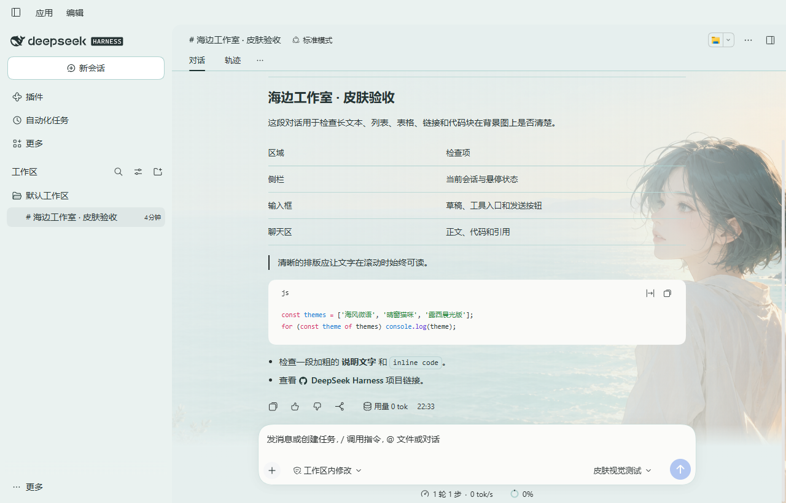

# DSH 一键换肤

把 DeepSeek Harness 换成一间看得见海的工作室，或让晒太阳的猫咪陪你读长对话。13 套浅色皮肤包括海岸、浮空庭院和霓虹机房。想用自己的照片或 AI 生成的图，也可以上传到「我的壁纸」，再搭一套喜欢的配色。

在通用设置里看图点选，聊天壁纸、侧栏、消息气泡、输入框、代码块和弹窗一起换色。窗口变窄时，壁纸会调整取景，消息区用与皮肤配色一致的遮罩衬出文字。




## 安装和使用

1. 在 DeepSeek Harness 桌面版的侧栏打开 **插件 → 添加插件**，输入 `github:superShen0916/dsh-work-skin#v1.1.0`。
2. 安装完成后点击 **立即启用**。
3. 打开 **设置 → 通用设置 → DSH 一键换肤**，展开预览并点击一套主题。

首次启用时保留当前外观。选好皮肤后，在同一个桌面用户配置里保持插件启用，重启 DSH 会自动应用上次选中的皮肤。点击 **恢复默认** 可回到换肤前的浅色、深色或跟随系统。

完整壁纸需要支持插件资源加载的 DSH 版本。本版在 **Windows 桌面版 0.2.2-rc.1** 上实测。 [下载固定版本安装包](https://github.com/superShen0916/dsh-work-skin/releases/tag/v1.1.0)


## 主题

海风微语、晴窗猫咪、风起云庭、露西晨光版、昼光协议、明雾机房、云端来信、月白庭院、纸上云汀、虹光观测站、橘园午后、浮鲸之境、黄金时刻。原作 13 套均为浅色。

## 自定义皮肤

展开皮肤预览，在 **自定义壁纸** 里上传 JPG、PNG 或 WebP（20 MB 以内），选择界面配色，再点 **应用我的壁纸**。插件会把图片缩至长边最多 1920 像素，并保存在当前桌面用户配置中。之后可以到预览里点 **我的壁纸** 切回来，也可以换图或重新搭配颜色。

要逐项调整配色和取景，可以复制仓库后替换 `assets/` 里的壁纸及缩略图，编辑 `themes.json`，运行 `npm run build` 后在 DSH 里添加修改过的本地项目目录。

## 开发

```sh
npm ci
npm run build
npm run check
npm test
npm pack
```

在 DSH 的「添加插件」中也可以输入本地项目目录。`themes.json` 保存原版配色和裁剪参数，并附有 DSH 窄窗裁剪参数。`src/palette.js` 映射原版配色到 DSH 的语义颜色。`lib/client.js` 由构建脚本生成，供 DSH 直接加载。

`scripts/verify-desktop.mjs` 可连接启用 Chromium 调试的隔离桌面实例，在预先打开的测试对话中验证 13 套皮肤、两种窗口宽度和重载恢复，并生成截图和 JSON 报告。

## 来源与许可

背景图和配色来自 [Doubao Work Skin 的 aaaf5a9 版本](https://github.com/superShen0916/doubao-work-skin/tree/aaaf5a945bc53d69799b6c736b819cb61a5f217f/skins)，保留了原版 PNG。背景为原项目维护者使用 GPT 生成。MIT 许可不授予其中可能涉及的第三方角色、商标或参考素材权利。

代码采用 [MIT](LICENSE) 许可。本项目由社区维护。
